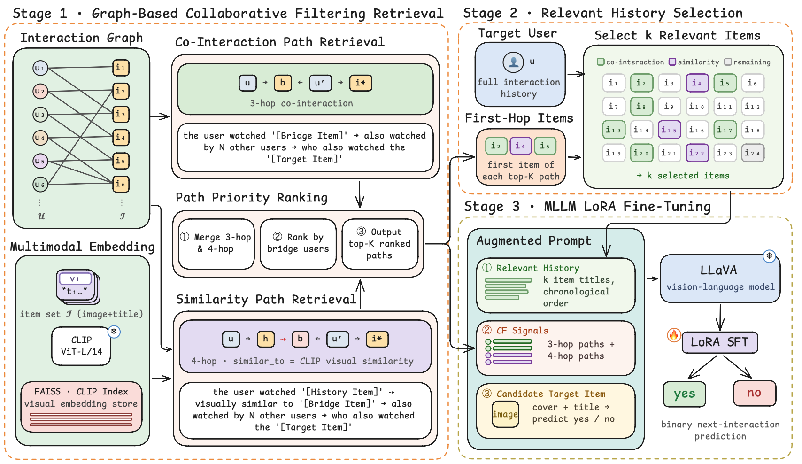

# MGRASRec

The code for the paper ["Multimodal Graph Retrieval-Augmented Sequential Recommendation via Collaborative Filtering Paths"](https://arxiv.org/abs/2610.11228) (Accepted by AJCAI 26).

## Overview

We propose MGRASRec, a multimodal graph retrieval-augmented framework for sequential recommendation. It retrieves structured paths from a user-item interaction graph, extended via multimodal similarity to go beyond exact co-interaction overlap, and injects these candidate-conditioned collaborative filtering signals into the MLLM prompt for parameter-efficient fine-tuning.




## Dataset
This paper utilizes the following datasets:
- **Microlens Dataset**: [GitHub Repository](https://github.com/westlake-repl/MicroLens)
- **Amazon Review Dataset**: [Amazon Reviews 2023](https://amazon-reviews-2023.github.io/#grouped-by-category)

The data processing scripts have been uploaded for preprocessing and structuring the datasets for model training and evaluation.

## Steps to Run

### 1. Preprocessing
Process and split the raw data into the required format.

**Amazon:**
```bash
python data/amazon/process_data.py
python data/amazon/download_images.py --dataset {Baby_Products,Video_Games}
python data/amazon/split.py {Baby_Products,Video_Games}
```

**Microlens:**

Run `data/microlens/preprocessing.ipynb`, then:
```bash
python data/microlens/split.py
```

### 2. Path Retrieval
Build the interaction graph and retrieve paths between users and items. Two retrieval methods are available: BFS and multimodal retrieval.

**Amazon:**
```bash
python path_retriever/amazon/dgl_extractor.py --category {Baby_Products,Video_Games} --split {trn,val,tst}
python path_retriever/amazon/bfs.py --dataset {Baby_Products,Video_Games} --split {trn,val,tst}
python path_retriever/clip_embedder.py --dataset {Baby_Products,Video_Games} --image_dir data/amazon/Amazon_images/{CATEGORY} --title_file data/amazon/processed/{CATEGORY}_item_desc.tsv --title_format tsv
python path_retriever/amazon/multimodal_retriever.py --dataset {Baby_Products,Video_Games} --split {trn,val,tst}
```

**Microlens:**
```bash
python path_retriever/microlens/dgl_extractor.py --split {trn,val,tst}
python path_retriever/microlens/bfs.py --split {trn,val,tst}
python path_retriever/clip_embedder.py --dataset microlens --image_dir data/microlens/MicroLens-50k_covers --title_file data/microlens/processed/MicroLens-50k_titles.csv --title_format csv
python path_retriever/microlens/multimodal_retriever.py --split {trn,val,tst}
```

### 3. Dataset Creation
Construct the training and test datasets using the retrieved paths.

**Amazon:**
```bash
python train/amazon/dataset_create_rag.py --dataset {Baby_Products,Video_Games}
python test/amazon/multi_col_dataset_rag.py --dataset {Baby_Products,Video_Games}
```

**Microlens:**
```bash
python train/microlens/dataset_create_rag.py
python test/microlens/multi_col_dataset_rag.py
```

### 4. Training
Perform supervised fine-tuning (SFT) of the recommender model.

**Amazon:**
```bash
python train/amazon/train_llava_sft.py --dataset {Baby_Products,Video_Games} --variant rag
```

**Microlens:**
```bash
python train/microlens/train_llava_sft.py --variant rag
```

### 5. Testing
Evaluate the trained recommender model.

**Amazon:**
```bash
python test/amazon/test_with_llava_sft.py --dataset {Baby_Products,Video_Games} --variant rag
```

**Microlens:**
```bash
python test/microlens/test_with_llava_sft.py --variant rag
```

## Citation

If you use the code of this repo, please cite our paper as,

```bibtex
@inproceedings{mgrasrec,
    author = {Jason Marcell Setiadi and Xin Cao and Lina Yao},
    title = {Multimodal Graph Retrieval-Augmented Sequential Recommendation via Collaborative Filtering Paths},
    booktitle = {39th Australasian Joint Conference on Artificial Intelligence (AJCAI)},
    year = {2026}
}
